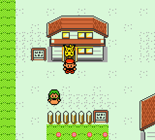
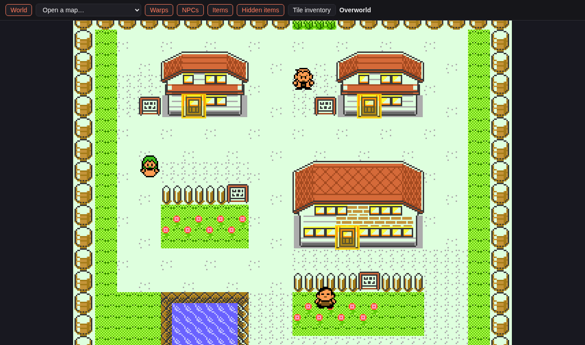
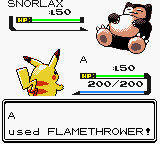
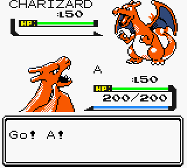
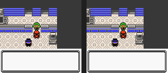
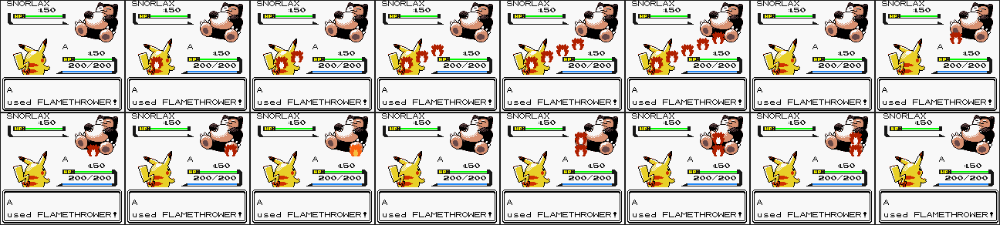

# Pokémon Yellow, full Game Boy Color

English Pokémon Yellow with Gen 2 sprites and per-tile Game Boy Color backgrounds. The overworld and interiors are colored tile by tile, the way Gold and Silver are, instead of with Yellow's four whole-screen palettes.



This is a fork of [dannye/pokeyellow-gen-2-gfx](https://github.com/dannye/pokeyellow-gen-2-gfx). The color engine comes from [dannye/pokered-gbc](https://github.com/dannye/pokered-gbc) (FroggestSpirit, Drenn, and dannye), adapted to Yellow.

## What this fork adds

- Per-tile background color on every map: town roof colors, wood, water, grass, and furniture palettes.
- Colored overworld sprites, including the yellow follower Pikachu.
- Battle transitions, text boxes, menus, the town map and Pikachu's portrait keep their colors.
- Many tiles that read as gray next to colored neighbors are recolored. Examples are flowers, signs, posts, stools, shelves, beds, stairs, cliffs and floors.
- The PC's item storage has 12 boxes of 50 items, switched with CHANGE BOX like the Pokémon boxes. Existing saves keep their items in box 1.

It is tested on a ModRetro Chromatic through an EverDrive-GB X7.

## Building

Follow [INSTALL.md](INSTALL.md) to install **rgbds 1.0.1**, then run `make`. The output is `pokeyellow.gbc`. `make compare` does not match the retail ROM in this fork.

## Map viewer

`tools/colormap.py` renders every map in its game colors from the source data. Run `make` first, then:

```
tools/colormap.py
```

Open `colormap/index.html` in a browser. You can:

- Pan and zoom the connected overworld.
- Click a door, ladder or stairs to open the map it leads to.
- Toggle warps, NPCs, items and hidden items.
- Browse every tileset's tiles with their assigned palettes.

The output folder is ignored by git.



## Battle preview

`tools/battlepreview.py` plays the built ROM in a headless emulator and captures battle scenes. Run `make` first, then:

```
tools/battlepreview.py                           # everything
tools/battlepreview.py --moves EMBER,SAND_ATTACK # just these moves
tools/battlepreview.py --mons                    # every Pokemon
tools/battlepreview.py --trainers BROCK          # one trainer intro
tools/battlepreview.py --link                    # link cable trade and battle
```

Open `battlepreview/index.html` to browse:

- **Moves:** each move's animation, as a GIF and as a sheet of every second frame. Pikachu uses the move on a Snorlax.
- **Pokémon:** the battle screen with that Pokémon on both sides, front and back sprites.
- **Trainers:** each trainer class's battle intro, from the transition to "X wants to fight!".
- **Link cable:** two Game Boys joined by a cable, side by side. `TRADE` goes from the Cable Club receptionist through the Trade Center to a full trade. `BATTLE` goes through the Colosseum into a link battle.

| Move | Pokémon | Trainer intro |
| --- | --- | --- |
|  |  |  |

With `--link`, two copies of the game run side by side on a scripted link cable. Player 1 is on the left:




Each move also gets a sheet of its frames, for spotting a single wrong frame:



`--moves`, `--mons` and `--trainers` take constant names from `constants/`, and `--link` takes `TRADE` or `BATTLE`. On their own they mean all of that kind, and with no option it captures everything. Other options are `--jobs N` (parallel emulators, one per CPU by default), `--rom FILE` (preview another build, for before/after comparisons) and an output directory.

It needs Python with Pillow, `git` and `gcc`. The first run clones [binjgb](https://github.com/binji/binjgb), applies `tools/binjgb-link.patch` (a link cable between two emulators in one process), and builds `tools/gbharness.c`, a small scripted runner on top of it, into `tools/.cache/`. That file's header lists the script commands if you want to drive the emulator for something else.

Some moves only work in a certain setup; `Game.SPECIAL` in the script handles those (Dream Eater on a sleeping target, for example). Mirror Move is skipped because it plays the copied move's animation. `battlepreview/` and `tools/.cache/` are ignored by git.

## Debugging on hardware

Two tools turn a problem seen on a real Game Boy into something you can inspect.

**Crash dumps.** If the game runs into $FF bytes it executes `rst $38`. Instead of looping there, the handler (`color/crash.asm`) saves the registers, the stack and HRAM to the battery save, turns the screen red and stops. Reset so the save gets written, then decode it with the `.sym` from the same build:

```
tools/crashdump.py "Pokemon Yellow.srm" pokeyellow.sym
```

**EverDrive snapshots.** The EverDrive GB X can save a snapshot of the running game to `GBCSYS/SNAP/<rom name>.sav`. `tools/snap2bess.py` converts it into a [BESS](https://github.com/LIJI32/SameBoy/blob/master/BESS.md) save state that SameBoy and other BESS emulators can load, with the same work RAM, video memory, palettes, registers and save RAM:

```
tools/snap2bess.py snap.sav snap.state pokeyellow.gbc
```

Use the exact ROM build that was on the cart when the snapshot was taken. A snapshot taken while the game is stuck can be loaded and traced in an emulator, even on a build without the crash handler.

---

Original README follows...

# pokeyellow-gen-2-gfx

Pokémon Yellow with 2nd Gen. Graphical Enhancements.

**Note:** This repository used to be called **pokeyellow-gen-II**.

Original README follows...

# Pokémon Yellow [![Build Status][ci-badge]][ci]

This is a disassembly of Pokémon Yellow.

It builds the following ROMs:

- Pokemon Yellow (UE) [C][!].gbc  `sha1: cc7d03262ebfaf2f06772c1a480c7d9d5f4a38e1`
- YELLMONS.GB (debug build) `sha1: d44e96eddfbdad633cbe4e6e64915e9e198974b0`
- Dmgapse0.h08.patch `sha1: f3346a5559d52c296b8feab0cdbbfb0e250ac161`

To set up the repository, see [**INSTALL.md**](INSTALL.md).


## See also

- [**Wiki**][wiki] (includes [tutorials][tutorials])
- [**Symbols**][symbols]
- [**Tools**][tools]

You can find us on [Discord (pret, #pokered)](https://discord.gg/d5dubZ3).

For other pret projects, see [pret.github.io](https://pret.github.io/).

[wiki]: https://github.com/pret/pokeyellow/wiki
[tutorials]: https://github.com/pret/pokeyellow/wiki/Tutorials
[symbols]: https://github.com/pret/pokeyellow/tree/symbols
[tools]: https://github.com/pret/gb-asm-tools
[ci]: https://github.com/pret/pokeyellow/actions
[ci-badge]: https://github.com/pret/pokeyellow/actions/workflows/main.yml/badge.svg
