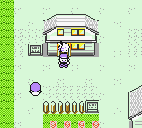
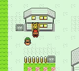
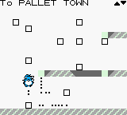
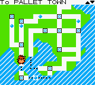
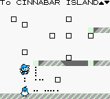
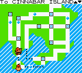
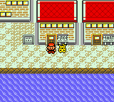
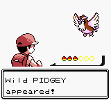
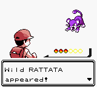
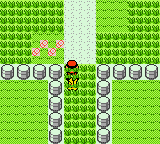

# Overworld color examples

Headless captures at 160×144. Each pair is the same moment on the ROM from before these three fixes and on the current build.

## Sprites

Outside Red's house in Pallet Town, the player and the follower used the area tint (purple). They now use their own palettes: red clothes and a skin-tone face, and a yellow Pikachu with red cheeks.

| Before | After |
| --- | --- |
|  |  |

## Fly town map

The map was readable, but its tiles took the overworld palette. It now uses the town-map palette (green land, blue water). The second row is the same map after the cursor moves from Pallet Town to Cinnabar Island.

| Before | After |
| --- | --- |
|  |  |
|  |  |

## Fly landing

Confirming Fly to Cinnabar restores per-tile map color and the sprite palettes. This is outdoors on Cinnabar, in front of the Pokémon Center.

| Cinnabar |
| --- |
|  |

## Wild battle

Entering a fight drops per-tile overworld color and uses Yellow's battle palettes. Leaving the fight brings the overworld colors back, including the yellow follower. The two intros are different species because the ROMs do not share the encounter roll: Pidgey before, Rattata after. The last shot is Route 1 after the Rattata faints.

| Before | After |
| --- | --- |
|  |  |

| Back on Route 1 |
| --- |
|  |
